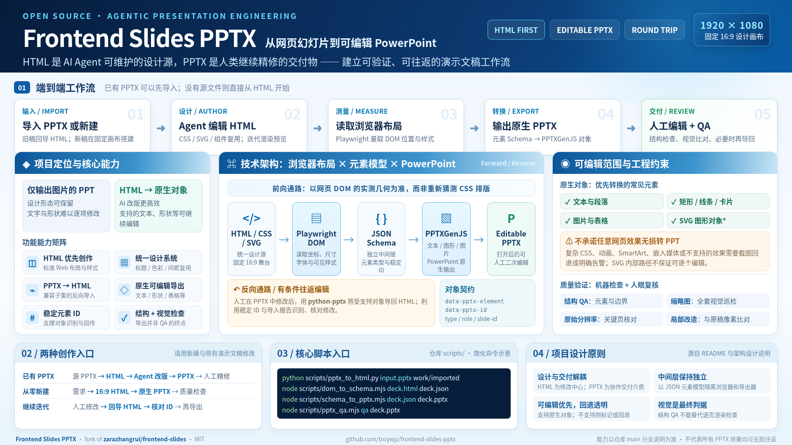

# Frontend Slides PPTX：发挥 AI 前端开发能力，生成原生可编辑 PPT 的 Agent 插件

## 一、为什么要让 AI 用前端技术制作 PPT？

AI Coding Agent 的前端开发能力，正在变得越来越强。

现在，Claude Code、Codex 等工具已经可以独立完成相当复杂的网页开发任务。从页面布局、视觉设计，到数据图表、SVG 图形、交互动画，AI 能够直接使用 HTML、CSS、JavaScript 等技术构建具有专业视觉效果的页面。

但这些能力，大部分仍然应用在网站和 Web 应用开发领域。

**如果将 AI 的前端开发能力直接用于制作 PPT，会发生什么？**

传统的程序化 PPT 生成方式，通常使用 python-pptx、PPTXGenJS 等工具，通过代码创建文本框、图形、图片等 PowerPoint 对象。

虽然能够生成可编辑文件，但对于复杂的视觉设计、信息图、数据可视化和灵活排版，往往需要编写大量坐标与样式代码。

相比之下，前端技术拥有成熟得多的视觉表达体系：

- **HTML/CSS：** 灵活布局、字体、渐变、阴影和复杂视觉效果。
- **SVG：** 精确绘制架构图、流程图、矢量图形。
- **JavaScript：** 数据可视化、交互效果与动画。
- **浏览器渲染：** 实时预览，快速调整设计效果。

更重要的是，这些正是 AI Coding Agent 已经非常熟悉和擅长使用的技术。

因此，我们可以换一种思路：**不再要求 AI 直接操作 PowerPoint，而是让它像开发网页一样，自由设计一套PPT。**

这也是开源项目 [Frontend Slides](https://github.com/zarazhangrui/frontend-slides) 的核心思路。

它以 HTML 为基础，将PPT制作转变成 AI 驱动的前端开发任务，并提供视觉风格探索、布局规范和 Coding Agent Skill。

不过，这条路线还有一个重要问题需要解决。

## 二、HTML 擅长设计，但人类更习惯编辑 PPT

通过 HTML 制作的PPT，可以具备精美的排版、复杂的数据图表以及丰富的视觉效果。

但是，当需要将成果交付给其他人时，就会遇到一个现实问题：

**大部分人并不希望通过修改 HTML 代码来调整PPT。**

他们仍然习惯使用 PowerPoint，直接拖动图形、修改文字、调整页面结构。

最简单的解决办法，是将每张 HTML 幻灯片截图，再插入 PPT。

但这样生成的 PPT，本质上只是图片集合。视觉效果虽然保留了，内部元素却无法独立编辑。

因此，一个更理想的工作流程应该是：

**AI 使用前端技术设计 → 导出原生可编辑 PPT → 人类使用 PowerPoint 修改 → 再交还 AI 继续调整。**

这就是我基于 Frontend Slides 进行二次开发，创建 **Frontend Slides PPTX** 的主要目标。

项目的重点不是重新开发一套 PPT 编辑器，而是打通 AI 前端设计与 PowerPoint 原生编辑之间的技术链路。

## 三、核心架构：从 HTML 到原生可编辑 PPTX

项目保留了 Frontend Slides 原有的 HTML 优先设计流程，并增加了一套原生 PowerPoint 转换机制。

核心技术链路为：

**HTML/CSS/SVG → DOM 测量 → JSON 元素模型 → PPTXGenJS → PPTX**

整个转换过程分为三个阶段。

### 1. AI 使用前端技术完成设计

Coding Agent 在固定的 1920 × 1080 画布上，通过 HTML、CSS 和 SVG 构建幻灯片。

标题、正文、图形和图表都可以按照前端开发的方式组织。

设计过程可以直接使用浏览器进行预览，并通过修改代码快速迭代。

### 2. 从浏览器中提取真实布局

项目使用 Playwright 读取页面 DOM，测量元素的位置、尺寸和样式。

随后，将这些信息转换为独立的 JSON 元素模型。

这一中间层将浏览器布局与 PowerPoint 生成逻辑解耦，使转换过程更加清晰，也为后续扩展提供了空间。

### 3. 生成 PowerPoint 原生对象

项目通过 PPTXGenJS，将支持的 HTML 元素转换为 PowerPoint 对象。

例如，文本可以成为文本框，基本图形可以成为形状，表格可以转换为相应的 PPT 对象。

**最终生成的 PPT 不再只是整页截图，而是包含可独立修改的原生元素。**

当然，HTML 和 PowerPoint 并不是完全等价的排版系统。

对于复杂 CSS 效果、动画和部分 SVG 内容，项目仍然保留图片回退机制，并通过转换报告提示无法完整编辑的部分。

## 四、更重要的一步：PPT 修改后还能交回 AI

如果只能实现 HTML 导出 PPTX，那么这个系统仍然是一条单向工作流。

真正有价值的是：**人类修改过的 PowerPoint，还能重新进入 AI 的开发流程。**

为此，项目为 HTML 元素设计了稳定的 `data-pptx-id` 标识，并在导出时保留对应信息。

当用户在 PowerPoint 中调整文字、位置或其他受支持的属性后，可以通过 Python 导入器重新解析 PPTX，恢复为 HTML。

由此形成一条双向工作流：

**AI 生成 HTML → 导出 PPTX → 人工修改 → 回导 HTML → AI 继续开发**

AI 维护可复用的前端代码，人类使用熟悉的 PowerPoint 工具调整内容。

双方不再需要使用同一种编辑方式。

目前，这一往返机制支持约定范围内的元素，并非任意 PPTX 都能无损转换。对于不支持的效果，系统会记录限制，避免在转换中悄悄丢失内容。

## 五、除了转换，还需要工程化质量控制

将 HTML 转换为 PPTX 并不是简单的格式处理。

浏览器与 PowerPoint 对文字换行、字体、行距和元素边界的处理可能不同。

因此，项目还增加了转换检查和质量验证机制，包括：

- 检查重复元素 ID、空占位符和越界对象。
- 识别可能导致转换失真的文本属性。
- 检查 PPTX 的页面结构和对象信息。
- 对导出的幻灯片进行渲染和视觉检查。
- 对已有 PPT 的局部修改，尽可能保留未经修改的原始页面。

这些机制的目的，是让 AI 生成的成果不只是视觉上可用，还能进入后续人工编辑和正式交付流程。

## 六、项目技术栈与使用方式

Frontend Slides PPTX 主要使用以下技术：

| 技术 | 主要用途 |
|---|---|
| HTML / CSS / SVG | 幻灯片设计与视觉表达 |
| JavaScript | 前端逻辑与数据可视化 |
| Playwright | DOM 测量与浏览器渲染 |
| JSON 元素模型 | 转换中间层 |
| PPTXGenJS | 原生 PPTX 对象生成 |
| python-pptx | PPTX 反向导入 |
| Node.js / Python | 转换脚本与质量检查 |

项目以 Coding Agent Skill 和插件形式提供使用入口，保留了原始项目的视觉风格探索与设计能力，同时增加可编辑 PPTX 转换、反向导入和质量验证工具。

既可以从零创建PPT，也可以先导入已有 PPTX，在 HTML 中修改指定页面，再将成果合入原始文件。

## 七、AI 制作 PPT，应该发挥 AI 真正擅长的能力

我认为，AI 制作 PPT 不应该局限于自动填写模板，或者简单地把内容排进现成的版式。

AI Coding Agent 已经具备较强的前端开发能力。借助成熟的 Web 技术，它可以完成复杂的视觉设计、技术架构图和数据可视化，将 PPT 制作转化为更灵活的前端开发任务。

但另一方面，PowerPoint 仍然是人类阅读、修改和交付PPT的重要工具。

因此，Frontend Slides PPTX 尝试解决的是两个相互关联的问题：

**第一，让 AI 充分利用前端开发能力，制作高质量的PPT。**

**第二，让 AI 生成的 HTML 与人类使用的 PowerPoint 能够双向转换、协同修改。**

目前项目已经实现了支持范围内的 HTML 与可编辑 PPTX 转换及往返工作流。复杂布局的保真度、对象兼容性和自动化验证仍然有进一步完善的空间。

从更长远的角度看，这也是我对 AI Agent 应用的一种探索：AI 不必完全替代人类熟悉的软件，而是利用自身擅长的技术与工作方式，通过可靠的转换接口，与现有工具形成协作。

**项目已开源，欢迎交流。**

GitHub：

https://github.com/troywjz/frontend-slides-pptx

*本项目基于 Frontend Slides 扩展开发，采用 MIT 开源许可证。*